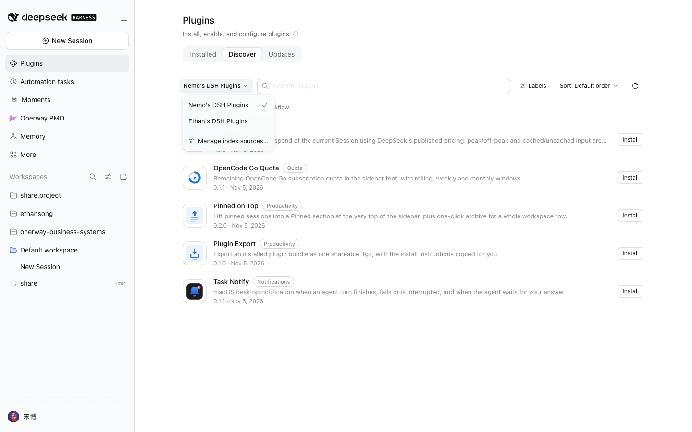
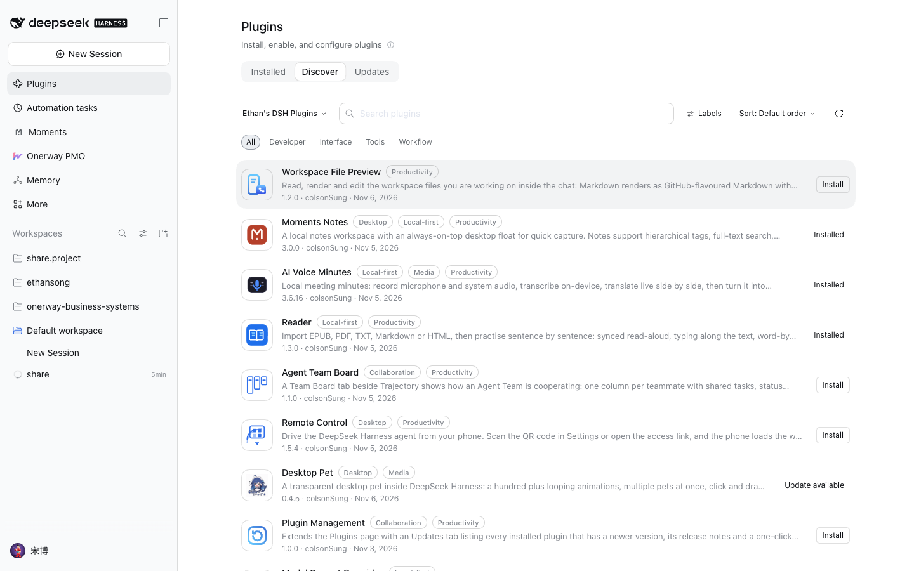

# Ethan's DSH Plugins — 插件分享源

这是一个 **DeepSeek Harness 插件市场索引**（plugin market index format 1），把 Ethan 在 GitHub 上公开的 DSH 插件汇成一个可以分享的「索引源」。任何人在 DSH 的插件页里把这个源加进去，就能在「发现」标签页里浏览并一键安装这些插件。

索引地址（GitHub Pages 托管）：

```
https://colsonsung.github.io/dsh-plugin-index/index.json
```

> 粘贴时必须全小写。DSH 要求索引 URL 是规范形式，GitHub Pages 的用户名会转成小写，写成 `colsonSung` 会被拒绝并提示「Index URL is not in canonical form」。

## 怎么在 DSH 里加上这个源

1. 打开 DSH 的**插件**页，切到**发现**（Discover）标签页。
2. 右上角的索引下拉框里点**管理索引源…**（Manage index sources…）。
3. 填入上面的 URL 并保存。
4. 回到「发现」标签页，索引下拉框里会出现 **Ethan's DSH Plugins**，选中即可浏览。



选中之后，「发现」页会列出下面这些插件：



> 索引源里的每个插件都按 commit 精确定位版本：安装的是索引发布那一刻的代码，不受仓库后续提交影响。

## 收录了哪些插件

| 插件 | 安装源 | 说明 |
|---|---|---|
| 工作区文件预览 | git | 在会话里预览/编辑工作区文件，框选标注交给智能体，面板内播放视频 |
| Moments 本地笔记 | git | 本地笔记工作台 + 桌面置顶速记浮窗 |
| AI 语音会议纪要 | git | 录麦克风与系统音、端侧转写、实时双语对照、生成纪要 |
| 英语精读 | git | 逐句精读、跟读、朗读比对、生词本、思维导图与播客 |
| 智能体团队看板 | git | 一列一个队友，看共享任务、token 成本与产出 |
| 手机远程控制 | git | 手机扫码经中继隧道驱动本机智能体 |
| 插件管理 | git | 插件页的更新页签、一键升级与插件分享 |
| 输入框伴侣 | git | 输入框右上角的皮卡丘：状态联动、喊名字对话、右键说指定的话/做动作、从记忆里挑话题 |
| 模型提示词增强 | git | 替换注入给模型的系统提示词，可按模型切换 |
| 桌面宠物 | npm | 透明动画桌宠，多开、拖拽、会话感知的工作动画 |
| 视频理解 | git | 传视频文件或贴链接：本地转写、说话人分离、画面字幕 OCR 与关键帧 |

未收录：**VS Code 扩展宿主**（`colsonSung/dsh-vscode-ext-host`）。它的插件包依赖构建产物（`plugin/main-host.js`、扩展宿主二进制由仓库根的 build 脚本生成），git 直装拿不到这些文件，装上也是坏的；等仓库改为提交构建产物或发布 npm 包后，在 `overrides.json` 里去掉排除项即可收录。

## 这个仓库怎么组织的

```
catalog.json      手写的展示元数据：中英文标题/描述、分类、标签、关键词、推荐度
overrides.json    按仓库的例外：排除某个插件，或把安装源从 git 换成 npm
tools/            生成器与校验器（见下）
index.json        生成产物：真正发布到 Pages 的索引文件
```

### 生成

```bash
npm install
npm run build      # catalog.json + overrides.json → index.json
npm run validate   # 用官方校验器校验 index.json，并打印每个插件的安装目标
```

`npm run build` 会去 GitHub 解析每个仓库默认分支的 HEAD commit、读取该 commit 下的 `package.json` 拿真实版本号、取提交时间作为 `publishTimestamp`、把图标内联成 base64 data URL。任何一个仓库的包名和 `catalog.json` 里写的对不上，构建会直接报错退出——防止索引指向错误的仓库。

### 校验

`npm run validate` 调用官方包 [`@deepseek-ai/dsh-plugin-market-index`](https://www.npmjs.com/package/@deepseek-ai/dsh-plugin-market-index) 的 `parseMarketIndex`，这是 DSH 自己读索引时用的同一套规则。校验通过后，它会用 `marketInstallTarget` 打印每个插件实际会执行的安装目标，例如：

```
git+https://github.com/colsonSung/dsh-reader.git#900e5d8e803f7b71710de07d5629a8bc0d952ea0&path:/plugin
```

### 发布

`index.json` 通过 GitHub Pages 的 `gh-pages` 分支发布：

```bash
npm run build && npm run validate
./scripts/publish-pages.sh
```

脚本把 `index.json` 和 `.nojekyll` 推到 `gh-pages` 分支，Pages 直接按静态文件伺服。

## 为什么有的插件走 npm 而不是 git

`dsh-pet` 走 npm：仓库里没有提交构建出来的 `lib/`，而 pnpm 10 对 git 依赖执行构建脚本有 `onlyBuiltDependencies` 白名单限制，新环境从 git 装必然失败；npm 上的发布包内含构建产物，装上即用。

其余插件走 git：包目录就是仓库根或 `plugin/` 子目录，代码完整，pnpm 能直接装。

## 许可证

索引内容（元数据与描述）随本仓库分发。各个插件各自的许可证见对应仓库的 LICENSE。
